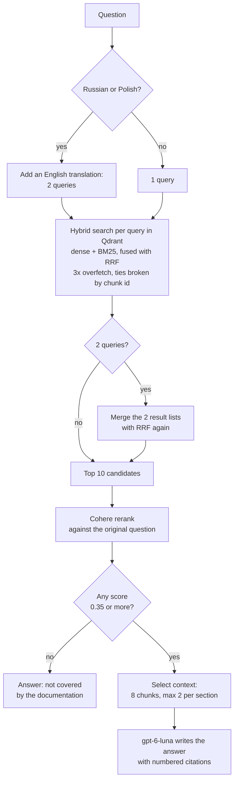
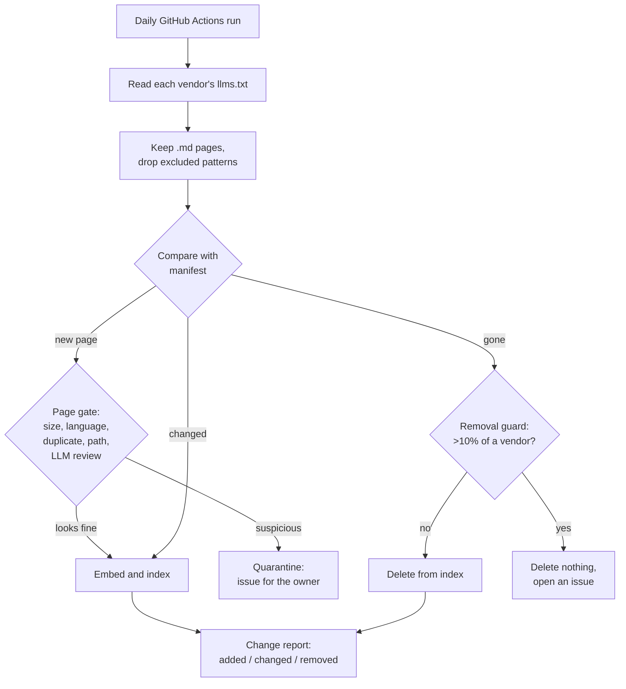

# Architecture, decisions and experiments

This document explains how the system works, why it is built this way, and
what the experiments showed. Every decision was kept or dropped because of a
measurement, not a guess. The full experiment log with every run is in
[docs/rag-findings.md](docs/rag-findings.md); raw outputs are in
[reports/](reports/).

**Contents:** [Glossary](#glossary) · [How a question is answered](#how-a-question-is-answered) ·
[How the index stays fresh](#how-the-index-stays-fresh) · [Decisions](#decisions) ·
[Experiments](#experiments) · [What we learned](#what-we-learned) ·
[Evaluation](#evaluation) · [Limits and open questions](#limits-and-open-questions)

---

## Glossary

Short definitions of every term used below.

| Term | Meaning |
|---|---|
| **RAG** (Retrieval-Augmented Generation) | First find relevant text, then let the language model answer only from that text. |
| **LLM** (Large Language Model) | A model such as GPT that writes text. Here: `gpt-6-luna`. |
| **MCP** (Model Context Protocol) | A standard way for AI agents to call external tools. This project is an MCP server with two tools. |
| **Chunk** | A piece of a documentation page (up to 3,000 characters) that is stored and searched on its own. |
| **Chunk overlap** | Neighbouring chunks share 300 characters, so a sentence cut at a border is still whole in one of them. |
| **Embedding** | A list of numbers that represents the meaning of a text. Texts with similar meaning get similar numbers. |
| **Dense search** | Search by meaning, using embeddings. Finds "add a tool server" for "connect an MCP server". |
| **BM25** (sparse search) | Classic keyword search. Finds exact names such as `.cursorrules` or `claude mcp add`, which dense search blurs. |
| **Hybrid search** | Dense and BM25 search run together and their results are merged. |
| **RRF** (Reciprocal Rank Fusion) | How the two result lists are merged: each result gets `1 / (60 + its rank)` from each list, and the points are added. It uses ranks, not scores, because the two scores are not comparable. Both lists count equally. |
| **Tie-break** | RRF often gives several chunks the same score. We sort ties by chunk id so the same question always gets the same results. |
| **Overfetch** | Asking the database for 3× more results than needed, so a group of tied results is never cut in the middle. |
| **Reranker** | A second, slower model that reads the question and each candidate together and scores how well they match (0–1). Here: Cohere `rerank-v4.0-fast`. |
| **Candidate pool** | How many search results go to the reranker (10 for answers, 20 for `search_docs`). |
| **top-k / `generation_top_k`** | How many chunks the LLM finally sees when it writes the answer (8). |
| **Grounded answer** | Every claim in the answer comes from the retrieved chunks and is cited as [1], [2]. |
| **Abstention** | The bot says "the documentation does not cover this" instead of guessing. |
| **Hit@k** | Did at least one correct chunk appear in the first *k* results? (1 = yes, 0 = no, averaged over questions.) |
| **MRR** (Mean Reciprocal Rank) | Average of `1 / rank of the first correct result`. 1.0 means the correct chunk is always first. |
| **Precision@k** | Share of the first *k* results that are relevant. |
| **nDCG** | Like precision, but a correct result at rank 1 counts more than at rank 8. |
| **Evidence coverage** | For a question with several parts: the share of parts for which a supporting chunk reached the LLM. "Complete" means all parts were covered. |
| **LLM-as-judge** | A second LLM grades answers against a written rubric. |
| **Faithfulness** | Share of the answer's claims that the retrieved text supports (no invented facts). |
| **MMR** (Maximal Marginal Relevance) | A selection method that prefers results unlike those already chosen. Tested here, not used. |
| **Qdrant** | The vector database that stores chunks, embeddings and BM25 data. |
| **Langfuse** | Observability tool: stores a trace of every request, the eval datasets and their results, and versioned prompts. |
| **Quarantine** | A newly found page that looks like junk is not indexed until the owner decides. |

---

## How a question is answered

This is the `ask_docs` path. Every step runs in order.

| Step | What it does | Why |
|---|---|---|
| 1. Translation | Adds an English copy of Russian or Polish questions; both are searched. | The docs are English. Translation lifted Hit@5 from 0.958 to 1.000; rewriting the question broke a case. |
| 2. Hybrid search | For each query, Qdrant runs dense and BM25 search, fuses them with RRF, returns 3x more than needed; ties are sorted by chunk id. With two queries, the two lists are fused with RRF once more. | Docs mix concepts (dense) with exact names of flags and files (BM25). The tie-break makes results repeatable. |
| 3. Rerank | Cohere re-scores the 10 candidates against the original question. | Search is fast but rough; the reranker is precise. |
| 4. Threshold | Candidates below 0.35 are dropped; if none remain, the bot says the docs do not cover it. | This is how the bot abstains instead of guessing. |
| 5. Context selection | Keeps the 8 best chunks, at most 2 from the same section. | Stops one section from filling the whole context. |
| 6. Generation | The LLM answers only from the 8 chunks, with numbered citations. | Answers stay grounded and checkable. |

`search_docs` is shorter: one query (no translation), an optional product
filter, a pool of 20 candidates, Cohere rerank, and the best `limit` passages
returned with their scores. There is no 0.35 threshold and no generation.

Every chunk is stored with a short header (vendor, product, page, section)
added before embedding. Without it, a chunk saying "set `model` in settings"
looks the same for Cursor and Claude Code.

The same pipeline is served two ways from one process: an **MCP server**
(`ask_docs`, `search_docs`) for agents and a **REST API** (`/ask`, `/search`)
for everything else. Both go through `src/service/core.py`, so they cannot
drift apart.

---

## How the index stays fresh

- **Which pages:** every Markdown page in each vendor's `llms.txt`, minus
  excludes for translations, changelogs, weekly news, concatenated dumps, old
  MCP spec versions, community pages and MCP proposals (`src/ingestion/sources.py`).
- **Page gate:** each new page is checked for free first (size, language,
  near-duplicate, suspicious path). Then the LLM reads its beginning and says in
  one sentence what the page is. Anything flagged goes to quarantine.
- **Cheap when nothing changed:** pages are fingerprinted; only changed pages
  are embedded again.
- **Change report:** each run writes a readable list of added, removed and
  significantly changed pages to the run summary and `reports/docs-changes/`.
  Only our summaries and links go to git, never the vendors' text.
- **Keep-alive:** the free Qdrant cluster sleeps after a week without requests;
  the daily run always makes one read.

---

## Decisions

| Decision | Why | Rejected alternative | Evidence |
|---|---|---|---|
| Hybrid search (dense + BM25) | Docs are full of exact names that dense search blurs. | Dense only | Design reasoning; on the original 35-page corpus every retrieval set reached Hit@5 = 1.0. |
| RRF with equal weights | Scores of the two searches are not comparable; ranks are. The reranker reorders afterwards anyway. | Tuned weights (convex combination) | Literature shows small gains from tuning; our bottleneck is after rerank. |
| Stable tie-break + 3× overfetch | Without it the same question returned different results. | Trust database order | Repeated runs moved coverage by ±1 case before the fix, 0 after. |
| Cohere rerank against the **original** question | The precise stage must judge the user's intent, not a rewrite. | Rerank against rewritten queries | — |
| Drop candidates below 0.35 | Gives a cheap way to abstain. | Always answer | The weakest truly relevant chunk scored 0.35 on 128 labelled chunks. |
| Pool of 10 candidates for answers | A larger pool pushed out the second topic of multi-part questions. | Pool of 20 | Complete coverage 0.750 (pool 10) vs 0.500 (pool 20). |
| 8 chunks to the LLM | Multi-part questions need room for every part. | 5 chunks | Complete coverage 0.250 → 0.750, faithfulness 0.938 → 0.956. |
| Max 2 chunks per section | Stops one section from taking every slot. | Per-document cap, MMR | Both alternatives broke cases where one page covers two topics. |
| Chunks of 3,000 chars, 300 overlap, split by headings first | Reranker judges whole paragraphs better; headings give each chunk an address. | Small chunks | 8 × 3,000 chars fits the context easily. |
| Context header in every chunk | Same words mean different things per product. | Raw text | Design reasoning; the answer judge also checks for citations to the wrong product. |
| Translate, never rewrite | Rewriting changes meaning. | Semantic query rewrite | Rewrite dropped an English case from MRR 1.0 to 0.25. |
| Single pass; two-hop search off by default | It did not help on average. | Iterative retrieval | Identical coverage (0.625 / 0.250) with and without it. |
| `gpt-6-luna` for generation | More faithful, same relevance. | `gpt-5.6-luna` | Faithfulness 0.975 → 0.994, citations 0.980 → 0.994. |
| MCP exposes only tools | Agents need actions; prompts belong in the client's plugin. | MCP prompts and resources | — |
| Typed tool errors | The agent should know whether to retry or tell the user. | Generic errors | — |
| Index everything minus excludes, with a gate | Users wanted the whole documentation; new pages arrive by themselves. | Hand-picked allow-list | 35 → ~600 pages. |
| Free hosting (Render, Qdrant Cloud, Langfuse Hobby) | Zero fixed cost, no bank card. | Paid hosting | See README → Cost. |

---

## Experiments

Each row is one hypothesis. "Kept" means it is in production.

| # | Hypothesis | How it was measured | Result | Verdict |
|---|---|---|---|---|
| 1 | Translating non-English questions helps | 48 questions × 4 variants, Hit@5 / MRR | Hit@5 0.958 → 1.000 | **Kept** |
| 2 | Rewriting questions helps | Same set | One English case MRR 1.0 → 0.25 | Rejected |
| 3 | A second search round finds missing parts | 16 multi-part questions, evidence coverage | 0.625 / 0.250 both ways | Off by default |
| 4 | Missing evidence is a search problem | Coverage among 20 candidates vs. in final context | 0.948 found → 0.646 delivered | **Disproved:** it is a selection problem |
| 5 | 5 chunks are enough room | Best possible pick of 5 vs. actual pick | Best 5 covers everything (0.875); actual pick 0.312 | Room is fine; the picker is the problem |
| 6 | More chunks help | 5 vs. 8 chunks, full pipeline with judge | Complete coverage 0.250 → 0.750 | **Kept (8)** |
| 7 | A bigger candidate pool helps | Pool 10 vs. 20 | 0.750 → 0.500 | Rejected (pool stays 10) |
| 8 | MMR diversifies the context | 5 chunks, λ = 0.6 | 0.688 vs. 0.771 for plain top-8 | Rejected |
| 9 | Per-document cap diversifies | 5 chunks, max 2 per doc | Better on average, broke one-page-two-topics cases | Rejected (per-section cap kept) |
| 10 | Picking chunks per aspect of the question | Frozen pool, offline | Complete coverage 0.50 → 0.69 | **Next step**, needs a holdout set |
| 11 | The two-hop judge knows when evidence is enough | Judge vs. ground truth on 16 contexts | Finds 7/8 real gaps, but calls 5/8 complete contexts incomplete | Judge too strict; not used |
| 12 | RRF is deterministic | Repeated identical queries | Results changed between calls | **Fixed** with tie-break |
| 13 | `gpt-6-luna` is at least as good | 16 + 12 questions, independent judge | Faithfulness 0.975 → 0.994 | **Kept** |
| 14 | Full corpus keeps quality | See [Evaluation](#evaluation) | See below | See below |
| 15 | Capping chunks per page in the candidate pool fixes the full-corpus drop | Cap None / 2 / 3, same gate | Cap 2: MRR 0.825 → 0.739, Hit@5 0.957 → 0.872; no more evidence in the pool | Rejected (setting kept, off by default) |

---

## What we learned

1. **The bottleneck is context assembly, not search.** The right page is almost
   always among the candidates; it gets lost when choosing what the LLM sees.
2. **More recall can mean worse answers.** A bigger pool adds more chunks of the
   first topic, which push out the second topic.
3. **One rerank against a multi-part question favours the first part.** Every
   chunk about part one outscores the best chunk about part two.
4. **Simple diversity tricks are not enough.** MMR and per-document caps help on
   average but break cases where one page answers two parts.
5. **Determinism matters for evals.** Without a stable tie-break, results moved
   by one case between identical runs.
6. **Measure, then drop what does not pay.** Two-hop search and query rewriting
   were built, measured and switched off.

---

## Evaluation

**Retrieval is scored by code**, because the correct pages are labelled in
advance: Hit@k, MRR, precision@k, nDCG, evidence coverage.

**Answers are scored by an LLM judge** that is a different model from the
generator: faithfulness, answer relevance, context utilisation, citation
correctness, a failure-mode label (none / refusal / empty / repeated /
did-not-follow-instructions), and correct abstention on 12 questions the
documentation cannot answer.

Datasets live in Langfuse: `rag/retrieval-v3`,
`rag/retrieval-query-transform-v1`, `rag/evidence-coverage-v1`,
`rag/negative-v1`, and `rag/full-corpus-v1` for the expanded index.

### Full corpus (October 2026)

The index grew from 35 hand-picked pages to ~600. The gate allows each
metric to drop by at most 0.03 against its last run before the change.

| Dataset | Metric | Before | After | Gate |
|---|---|---|---|---|
| `retrieval-v3` | Hit@5 | 0.979 | 0.957 | pass |
| `retrieval-v3` | MRR | 0.865 | 0.826 | **fail** |
| `retrieval-query-transform-v1` | Hit@5 | 0.875 | 0.979 | pass |
| `retrieval-query-transform-v1` | MRR | 0.859 | 0.767 | **fail** |
| `evidence-coverage-v1` | Complete coverage | 0.750 | 0.625 | **fail** |
| `evidence-coverage-v1` | Faithfulness | 0.994 | 0.987 | pass |
| `negative-v1` | Correct abstention | 1.000 | 1.000 | pass |
| `full-corpus-v1` (new topics) | Hit@5 | — | 1.000 | pass (≥ 0.9) |

What it means in plain words:

- **The bot now answers questions it could not answer before** (new topics: Hit@5 1.00).
- **It still refuses correctly** on questions outside the documentation.
- **It is still faithful:** answers stick to the sources.
- **But the right page now sits a little lower in the ranking**, and multi-part
  questions are fully covered less often. Of the 81 results that ranked above
  the first correct one, 52 came from newly added pages, mostly enterprise,
  security and integration guides.
- This confirms [finding 2](#what-we-learned): more candidates crowd out the
  right ones.

Before the comparison, three negative questions (pricing, an old protocol
version) were replaced, because the larger corpus now answers them. Seven
labels were also extended where a newly indexed page was a valid answer.
Every change is listed with evidence in
[reports/full-corpus-eval-2026-10.md](reports/full-corpus-eval-2026-10.md).

**Tried next: a per-page cap on the candidate pool (experiment 15).** It did
not help. Re-run in the same session, today's numbers reproduced the failure.

| Dataset | Metric | Gate | No cap | Cap 2 | Cap 3 |
|---|---|---|---|---|---|
| `retrieval-v3` | Hit@5 | ≥ 0.949 | 0.957 | **0.872** | n/a |
| `retrieval-v3` | MRR | ≥ 0.835 | **0.825** | **0.739** | n/a (0.713 without rerank, vs. 0.739) |
| `retrieval-query-transform-v1` | Hit@5 | ≥ 0.845 | 0.938 | 0.896 | n/a |
| `retrieval-query-transform-v1` | MRR | ≥ 0.829 | **0.757** | **0.704** | n/a (0.732 without rerank, vs. 0.788) |
| `evidence-coverage-v1` | Complete coverage | ≥ 0.720 | **0.625** | n/a | n/a |
| `evidence-coverage-v1` | Faithfulness | ≥ 0.964 | 0.998 | n/a | n/a |
| `negative-v1` | Correct abstention | 1.000 | 1.000 | n/a | n/a |
| `full-corpus-v1` | Hit@5 | ≥ 0.9 | 1.000 | n/a | n/a |

"n/a": the Cohere trial key hit its monthly limit of 1000 calls in the middle
of the cap 2 runs, so those runs could not rerank.

What it means in plain words:

- **Cap 2 makes ranking clearly worse.** It throws away a good second chunk
  from the right page and lets in more neighbouring pages.
- **The cap does not bring the missing evidence in.** In the cases that are
  still incomplete, the pool already has at most two chunks per page. The
  right page is beaten by other pages: cloud-agent and self-hosted guides,
  GitHub and GitLab integrations, SDK reference and spec pages.
- So the setting stays in the code, **off by default**.

**Next:** rank guide pages above enterprise, integration, reference and spec
pages unless the question asks for them (a page-type prior or tiered index).
Details in [reports/per-page-cap-2026-10.md](reports/per-page-cap-2026-10.md).
The MCP `schema.md` page was suspected, but it never reached the top 10.

---

## Limits and open questions

- **Small datasets.** 16 multi-part questions, ground truth written by the author.
  One case = 0.0625 of complete coverage.
- **The generator is not deterministic**, even with fixed inputs.
- **Ranking dropped with the full corpus** (see above): Hit@5 holds, but the
  right page ranks lower and multi-part coverage fell. This is being fixed.
- **Free-tier limits:** Cohere trial (1,000 calls/month per key, 10/minute),
  Render sleeps after 15 minutes idle (first request ~1 minute).
- **Open:** a smarter context selector (experiment 10); a no-rerank fallback
  when the Cohere quota runs out; sampled LLM-judge scoring of production traffic.
