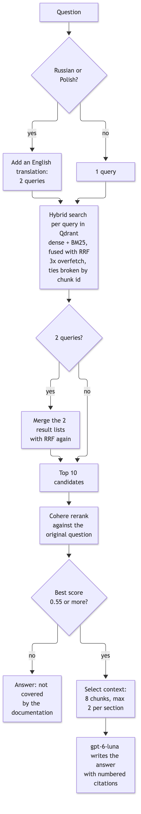
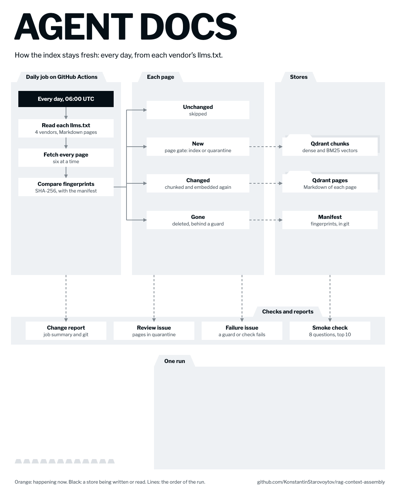

# Architecture, decisions and experiments

This document explains how the system works, why it is built this way, and
what the experiments showed. Every decision was kept or dropped because of a
measurement, not a guess. The full experiment log with every run is in
[docs/rag-findings.md](docs/rag-findings.md); raw outputs are in
[reports/](reports/).

**Contents:** [Glossary](#glossary) · [How a question is answered](#how-a-question-is-answered) ·
[How the index stays fresh](#how-the-index-stays-fresh) · [Decisions](#decisions) ·
[Experiments](#experiments) · [What we learned](#what-we-learned) ·
[Evaluation](#evaluation) · [Limits and open questions](#limits-and-open-questions)

---

## Glossary

Short definitions of every term used below.

| Term | Meaning |
|---|---|
| **RAG** (Retrieval-Augmented Generation) | First find relevant text, then let the language model answer only from that text. |
| **LLM** (Large Language Model) | A model such as GPT that writes text. Here: `gpt-6-luna`. |
| **MCP** (Model Context Protocol) | A standard way for AI agents to call external tools. This project is an MCP server with two tools: `search_docs` and `read_section`. |
| **Chunk** | A piece of a documentation page (up to 3,000 characters) that is stored and searched on its own. |
| **Chunk overlap** | Neighbouring chunks share 300 characters, so a sentence cut at a border is still whole in one of them. |
| **Embedding** | A list of numbers that represents the meaning of a text. Texts with similar meaning get similar numbers. |
| **Dense search** | Search by meaning, using embeddings. Finds "add a tool server" for "connect an MCP server". |
| **BM25** (sparse search) | Classic keyword search. Finds exact names such as `.cursorrules` or `claude mcp add`, which dense search blurs. |
| **Hybrid search** | Dense and BM25 search run together and their results are merged. |
| **RRF** (Reciprocal Rank Fusion) | How the two result lists are merged: each result gets `1 / (60 + its rank)` from each list, and the points are added. It uses ranks, not scores, because the two scores are not comparable. Both lists count equally. |
| **Tie-break** | RRF often gives several chunks the same score. We sort ties by chunk id so the same question always gets the same results. |
| **Overfetch** | Asking the database for 3× more results than needed, so a group of tied results is never cut in the middle. |
| **Prefetch depth** | How far down each list (dense and BM25) the database reads before merging them with RRF. Today 3× the number of results asked for (30 for answers). Setting: `HYBRID_PREFETCH_DEPTH`. |
| **Reranker** | A second, slower model that reads the question and each candidate together and scores how well they match (0–1). Here: Cohere `rerank-v4.0-fast`. |
| **Candidate pool** | How many search results go to the reranker (10 for answers, 20 for `search_docs`). Setting: `RERANK_POOL`; the reranker still returns `RETRIEVAL_TOP_K`. |
| **Recall@pool** | Share of questions with at least one correct chunk inside the candidate pool. It is the most the reranker can find. |
| **top-k / `generation_top_k`** | How many chunks the LLM finally sees when it writes the answer (8). |
| **Grounded answer** | Every claim in the answer comes from the retrieved chunks and is cited as [1], [2]. |
| **Abstention** | The bot says "the documentation does not cover this" instead of guessing. |
| **Hit@k** | Did at least one correct chunk appear in the first *k* results? (1 = yes, 0 = no, averaged over questions.) |
| **MRR** (Mean Reciprocal Rank) | Average of `1 / rank of the first correct result`. 1.0 means the correct chunk is always first. |
| **Precision@k** | Share of the first *k* results that are relevant. |
| **nDCG** | Like precision, but a correct result at rank 1 counts more than at rank 8. |
| **Evidence coverage** | For a question with several parts: the share of parts for which a supporting chunk reached the LLM. "Complete" means all parts were covered. |
| **LLM-as-judge** | A second LLM grades answers against a written rubric. |
| **Faithfulness** | Share of the answer's claims that the retrieved text supports (no invented facts). |
| **MMR** (Maximal Marginal Relevance) | A selection method that prefers results unlike those already chosen. Tested here, not used. |
| **Qdrant** | The vector database that stores chunks, embeddings and BM25 data. |
| **Langfuse** | Observability tool: stores a trace of every request, the eval datasets and their results, and versioned prompts. |
| **Page snapshot** | The last fetched Markdown of a page, with its one-sentence description, kept in Qdrant (`<collection>_pages`). `read_section` reads sections from it. Pages indexed before the page gate existed had no description; `python -m src.reindex --generate-missing-summaries` writes one per page (one short LLM call each, no re-embedding). |
| **Quarantine** | A newly found page that looks like junk is not indexed until the owner decides. |

---

## How a question is answered

This is the `/ask` path (REST; agents use `search_docs` and `read_section` instead). Every step runs in order.

<picture>
  <source media="(prefers-color-scheme: dark)" srcset="docs/diagrams/architecture-ask-path-dark.png">
  
</picture>

Diagram source: [docs/diagrams/architecture-ask-path.mmd](docs/diagrams/architecture-ask-path.mmd)

| Step | What it does | Why |
|---|---|---|
| 1. Translation | Adds an English copy of Russian or Polish questions; both are searched. | The docs are English. Translation lifted Hit@5 from 0.958 to 1.000; rewriting the question broke a case. |
| 2. Hybrid search | For each query, Qdrant runs dense and BM25 search, fuses them with RRF, returns 3x more than needed; ties are sorted by chunk id. With two queries, the two lists are fused with RRF once more. | Docs mix concepts (dense) with exact names of flags and files (BM25). The tie-break makes results repeatable. |
| 3. Rerank | Cohere re-scores the 10 candidates against the original question. | Search is fast but rough; the reranker is precise. |
| 4. Threshold | If the best candidate scores below 0.55, the bot says the docs do not cover it, without calling the LLM. Otherwise candidates below 0.35 are dropped. | This is how the bot abstains instead of guessing. |
| 5. Context selection | Keeps the 8 best chunks, at most 2 from the same section. | Stops one section from filling the whole context. |
| 6. Generation | The LLM answers only from the 8 chunks, with numbered citations. | Answers stay grounded and checkable. |

`search_docs` is shorter: one query (no translation), an optional product
filter, a pool of 20 candidates, Cohere rerank, and the best passage of each
page; the first `limit` are returned with their scores and the page's one-line description (one Qdrant read of the page snapshots for all results). Each passage also names the page's other chunks that score at least 0.35, by heading only, at most three (`other_sections`), so the agent can open them with `read_section`. There is no 0.35 threshold on the passages themselves and no generation.

Every chunk is stored with a short header (vendor, product, page, section)
added before embedding. Without it, a chunk saying "set `model` in settings"
looks the same for Cursor and Claude Code.

The same pipeline is served two ways from one process: an **MCP server**
(`search_docs`, `read_section`) for agents and a **REST API** (`/ask`,
`/search`, `/pages`, `/section`) for everything else. Both go through
`src/service/`, so they cannot drift apart.

---

## How the index stays fresh

<picture>
  <source media="(prefers-color-scheme: dark)" srcset="docs/flow/reindex-flow-dark.gif">
  
</picture>

[Step by step](https://konstantinstarovoytov.github.io/agent-docs/?flow=reindex) · source: [docs/flow/flows/reindex.js](docs/flow/flows/reindex.js)

- **Which pages:** every Markdown page in each vendor's `llms.txt`, minus
  excludes for translations, changelogs and release notes, weekly news,
  concatenated dumps, old MCP spec versions, community pages, MCP proposals,
  legal and marketing pages, and pages that only link elsewhere
  (`src/ingestion/sources.py`). Large references (settings, env vars, errors,
  SDK and API references, the MCP schema) are on an allow list so the size
  check does not quarantine them. Decisions per page:
  [reports/index-v2-2026-10.md](reports/index-v2-2026-10.md).
- **Page gate:** each new page is checked for free first (size, language,
  near-duplicate, suspicious path). Then the LLM reads its beginning and says in
  one sentence what the page is. Anything flagged goes to quarantine.
- **Cheap when nothing changed:** pages are fingerprinted (SHA-256 of the
  Markdown and the chunker version); only new and changed pages are embedded
  again. A new chunker version therefore re-embeds every page once.
- **Fetch failures:** a page that fails to fetch keeps its indexed copy; if more
  than 10% of a vendor's pages fail, the run fails.
- **Removals:** a page that leaves `llms.txt` or becomes excluded is deleted
  from the chunks, the stored pages and the manifest, unless more than 10% of a
  vendor's indexed pages would go or its `llms.txt` lists under half of them;
  then nothing is deleted for that vendor and the run fails.
- **Smoke check:** after the index changes, 8 known questions must still find
  their page in the top 10 of a hybrid search, or the run fails.
- **Issues:** quarantined pages wait in one "Pages waiting for review" issue,
  each with two boxes. **Index** puts the page on the allow list
  (`data/page-decisions.json`, read with `allow` in `sources.py`); **Decline**
  keeps it out until the page changes, then it comes back to the issue rather
  than to the gate. Only the repository owner's ticks count; the issue closes
  when nothing waits. A failed run opens "Reindex needs attention" with the end
  of its log.
- **Change report:** each run writes a readable list of added, removed and
  significantly changed pages to the run summary and `reports/docs-changes/`.
  Only our summaries and links go to git, never the vendors' text.
- **Keep-alive:** the free Qdrant cluster sleeps after a week without requests;
  the daily run always makes one read.

---

## Decisions

| Decision | Why | Rejected alternative | Evidence |
|---|---|---|---|
| Hybrid search (dense + BM25) | Docs are full of exact names that dense search blurs. | Dense only | Design reasoning; on the original 35-page corpus every retrieval set reached Hit@5 = 1.0. |
| RRF with equal weights | Scores of the two searches are not comparable; ranks are. The reranker reorders afterwards anyway. | Tuned weights (convex combination) | Literature shows small gains from tuning; our bottleneck is after rerank. |
| Stable tie-break + 3× overfetch | Without it the same question returned different results. | Trust database order | Repeated runs moved coverage by ±1 case before the fix, 0 after. |
| Cohere rerank against the **original** question | The precise stage must judge the user's intent, not a rewrite. | Rerank against rewritten queries | — |
| Drop candidates below 0.35 | Gives a cheap way to abstain. | Always answer | The weakest truly relevant chunk scored 0.35 on 128 labelled chunks. |
| Pool of 10 candidates for answers | A larger pool pushed out the second topic of multi-part questions. | Pool of 20 | Complete coverage 0.750 (pool 10) vs 0.500 (pool 20). |
| 8 chunks to the LLM | Multi-part questions need room for every part. | 5 chunks | Complete coverage 0.250 → 0.750, faithfulness 0.938 → 0.956. |
| Max 2 chunks per section | Stops one section from taking every slot. | Per-document cap, MMR | Both alternatives broke cases where one page covers two topics. |
| Chunks of 3,000 chars, 300 overlap, split by headings first | Reranker judges whole paragraphs better; headings give each chunk an address. | Small chunks | 8 × 3,000 chars fits the context easily. |
| Context header in every chunk | Same words mean different things per product. | Raw text | Design reasoning; the answer judge also checks for citations to the wrong product. |
| Translate, never rewrite | Rewriting changes meaning. | Semantic query rewrite | Rewrite dropped an English case from MRR 1.0 to 0.25. |
| Single pass; two-hop search off by default | It did not help on average. | Iterative retrieval | Identical coverage (0.625 / 0.250) with and without it. |
| `gpt-6-luna` for generation | More faithful, same relevance. | `gpt-5.6-luna` | Faithfulness 0.975 → 0.994, citations 0.980 → 0.994. |
| MCP exposes only tools | Agents need actions; prompts belong in the client's plugin. | MCP prompts and resources | — |
| Typed tool errors | The agent should know whether to retry or tell the user. | Generic errors | — |
| Index everything minus excludes, with a gate | Users wanted the whole documentation; new pages arrive by themselves. | Hand-picked allow-list | 35 → ~600 pages. |
| Free hosting (Render, Qdrant Cloud, Langfuse Hobby) | Zero fixed cost, no bank card. | Paid hosting | See README → Cost. |
| `search_docs` returns one passage per page | Several chunks of one page filled the list; the agent can search again per part. | All chunks in score order | retrieval-v3, limit 5: distinct pages 3.1 → 5.0, page hit@5 0.936 → 0.979 (experiment 22). |
| Passages name the page's other matching sections (`other_sections`) | One passage per page hides a second relevant section of the same page; headings point the agent to `read_section` without taking a result slot. | Two passages per page; a second one only when it scores near the best | Section hit 0.667 → 0.867 on retrieval-v3, page hit unchanged, +8–10% tokens; two passages per page pushed pages out, all-groups coverage @5 0.438 → 0.312 (experiment 25); with real agents (experiment 26) correctness is unchanged and failed reads on guessed headings drop (7 → 1, 4 → 0). |
| Abstain when the best score is below 0.55 (`MIN_TOP_RERANK_SCORE`) | Saves the LLM call when nothing in the docs fits. | Raise the 0.35 per-chunk floor | Lowest top score of 131 answerable questions 0.64 (margin 0.09); catches 8 of 12 negatives (experiment 23). |
| `find_pages` + `read_section`: pick pages from cards, then read whole sections from the page snapshot | A 3,000-char chunk can cut a section; the agent should read the section itself. Same ranking as `search_docs`, no extra Cohere call, no model call to read. | More or longer passages from `search_docs` | find_pages page hit@5 0.979 on retrieval-v3; read_section returns the labelled section for 25 of 25 labels once every page has a snapshot (experiment 24). The `find_pages` card is now REST `/pages`; on MCP `search_docs` carries the description. |
| Two MCP tools, no LLM on the agent path | Agents generate the answer themselves; a second generation costs money and hides the sources. `search_docs` gives passages with page descriptions, `read_section` gives whole sections. | `ask_docs` and `find_pages` as extra MCP tools | Production traces, 30 days: agents chose `search_docs` 103 times and `ask_docs` 11. `/ask` and `/pages` stay on REST. |
| `read_section(url)` returns a compact outline: h1–h2 with subsection counts, 40 lines at most; `outline_depth=3` adds h3 | The full outline of `hooks.md` was 166 headings, about 1,000 tokens per call; an h2's text already includes its subsections, so the agent rarely needs the deep headings. | Every heading (the old outline) | Over 617 pages (chars/4): median 86 → 52 tokens, p90 268 → 93, max 1,987 → 374; `hooks.md` 1,038 → 91. |
| Public access with the caller's own Cohere key (`X-Cohere-Api-Key`, no token needed) | Rerank is the only metered resource; it moves to the caller. Embedding cost is negligible and bounded by 30 requests/min per IP plus the global limit. The key is used for that request only: never stored, logged or traced. | Hand out guest tokens only | — |
| Only `tools/call` needs credentials: every other MCP message answers without a token or key; `GET`/`DELETE /mcp` answer 405 for everyone; `/.well-known/*` is public | Only a tool call costs money (embedding, rerank). Glama's connection test sends more than `initialize` and `tools/list`: an allow-list of discovery methods still failed it with 401, and so did the 401 on its GET stream and OAuth-metadata probes. The server is stateless, so a GET stream would only hold a connection open; the spec allows 405. | An allow-list of discovery methods; health-check credentials stored in each directory | Anonymous requests share the 30 requests/min per-IP limit; `tools/call` without a token or key is still refused (401); an OAuth probe gets a plain 404. |

---

## Experiments

Each row is one hypothesis. "Kept" means it is in production.

| # | Hypothesis | How it was measured | Result | Verdict |
|---|---|---|---|---|
| 1 | Translating non-English questions helps | 48 questions × 4 variants, Hit@5 / MRR | Hit@5 0.958 → 1.000 | **Kept** |
| 2 | Rewriting questions helps | Same set | One English case MRR 1.0 → 0.25 | Rejected |
| 3 | A second search round finds missing parts | 16 multi-part questions, evidence coverage | 0.625 / 0.250 both ways | Off by default |
| 4 | Missing evidence is a search problem | Coverage among 20 candidates vs. in final context | 0.948 found → 0.646 delivered | **Disproved:** it is a selection problem |
| 5 | 5 chunks are enough room | Best possible pick of 5 vs. actual pick | Best 5 covers everything (0.875); actual pick 0.312 | Room is fine; the picker is the problem |
| 6 | More chunks help | 5 vs. 8 chunks, full pipeline with judge | Complete coverage 0.250 → 0.750 | **Kept (8)** |
| 7 | A bigger candidate pool helps | Pool 10 vs. 20 | 0.750 → 0.500 | Rejected (pool stays 10) |
| 8 | MMR diversifies the context | 5 chunks, λ = 0.6 | 0.688 vs. 0.771 for plain top-8 | Rejected |
| 9 | Per-document cap diversifies | 5 chunks, max 2 per doc | Better on average, broke one-page-two-topics cases | Rejected (per-section cap kept) |
| 10 | Picking chunks per aspect of the question | Frozen pool, offline | Complete coverage 0.50 → 0.69 | Not started: needs a holdout set. Applies to `/ask` only; agents get no context selection, and `search_docs` asks them to search one topic per call |
| 11 | The two-hop judge knows when evidence is enough | Judge vs. ground truth on 16 contexts | Finds 7/8 real gaps, but calls 5/8 complete contexts incomplete | Judge too strict; not used |
| 12 | RRF is deterministic | Repeated identical queries | Results changed between calls | **Fixed** with tie-break |
| 13 | `gpt-6-luna` is at least as good | 16 + 12 questions, independent judge | Faithfulness 0.975 → 0.994 | **Kept** |
| 14 | Full corpus keeps quality | See [Evaluation](#evaluation) | See below | See below |
| 15 | Capping chunks per page in the candidate pool fixes the full-corpus drop | Cap None / 2 / 3, same gate | Cap 2: MRR 0.825 → 0.739, Hit@5 0.957 → 0.872; no more evidence in the pool | Rejected (setting kept, off by default) |
| 16 | The full-corpus misses are a search problem | Where each correct chunk is lost, on the real index, with the gate's stored rerank scores (89 questions and evidence groups) | 10 misses: 7 outside the pool of 10, 3 not in the top 30 of either search, 0 lost by the reranker. Chunks ranked above the right one are 65% guide pages; MRR falls in 3 intents | **Partly confirmed:** coverage loss is the pool cut; the MRR loss is ranking among plausible pages and two unlabelled correct answers |
| 17 | A deeper prefetch or a bigger pool brings the right chunk back | Recall@pool for prefetch 30/60/100/150 × pool 10/20/40/60, no reranker | Prefetch changes nothing. Pool 20 / 40: complete coverage in the pool 0.625 → 0.750 / 0.875 | Reranked (pool 40, prefetch 60): hit@5 0.979 → 0.915, MRR 0.847 → 0.839, complete coverage 0.250 → 0.250 (evidence runner). **Rejected;** defaults unchanged |
| 18 | BM25 needs IDF (v1 sparse vector has no `modifier=IDF`) | Index v2 built with IDF; recall-in-pool at pools 10/20/40, no reranker | Recall unchanged on all four datasets; first-correct rank before rerank slightly lower | **Pending** reranked gate on v2 (November) |
| 19 | Excluding changelogs, legal, marketing and link-hub pages cleans the pool | 40 quarantined pages excluded, 20 large references allowed; same recall run | Same groups lost as in v1 | Kept (corpus hygiene), in v1 too since the 2026-10-14 reindex; no recall effect |
| 20 | One reference entry per chunk (`####` split, 12-row tables with header) | Chunk counts per big page; same recall run | e.g. hooks 125 → 184 chunks, median 2,571 → 1,188 chars; recall unchanged | **Live in v1** since the 2026-10-14 reindex re-chunked every page; its reranked gate is still pending (November) |
| 21 | A product filter on answers recovers evidence | v2 with the vendor the labels name (56 of 91 cases) | Coverage recall pool 10 0.765 → 0.794, pool 40 0.912 → 0.941; retrieval-v3 pool 40 → 1.000 | **Accepted** as optional `product` on `/ask` and `search_docs` |
| 22 | One passage per page makes `search_docs` show more pages | Stored Cohere scores, search pool 20 rebuilt from Qdrant; page hit@k, before → after | retrieval-v3 (47, all scored): limit 5 hit 0.936 → 0.979, pages 3.1 → 5.0; limit 8 hit 0.979 → 0.979, pages 4.4 → 7.4. Query-transform and full-corpus only partly scored, no hit lost | **Kept** |
| 23 | The best rerank score tells when the docs do not cover a question | Top score on the `/ask` path (pool 10) from stored scores: 131 answerable questions, 12 negatives | Lowest answerable 0.64; negatives below 0.55: 8 of 12 (the 0.35 floor already empties 5) | **Kept**, default 0.55 |
| 24 | Page cards plus section reads find and return the right section | Stored Cohere scores, search pool 20 (0 Cohere calls); `read_section` on the 25 labels that name a heading | Page hit@3 / @5: retrieval-v3 0.936 / 0.979; evidence groups (one call per question) 0.500 / 0.647. read_section: 11 of 25 on v1 today (14 fail: 28 v1 pages have no snapshot), 25 of 25 with them filled; median 1,415 chars, p95 7,941 | **Kept**; every v1 page has a snapshot since the 2026-10-14 reindex (591 of 591) ([report](reports/find-pages-2026-10.md)) |
| 25 | Showing more than one passage per page helps agents find the right section | Same pools and Cohere scores (pool 20, 83 questions, all fully scored); A one per page, B up to two, C a second only if ≥ 0.8 × best, D one per page plus the headings of the page's other chunks ≥ 0.35 | retrieval-v3 section hit 0.667 → 0.867 with D, page hit unchanged, +8–10% tokens; B and C lose pages (all-groups coverage @5 0.438 → 0.312) | **Kept**: implemented as `other_sections` ([report](reports/passages-per-page-2026-10.md)) |
| 26 | Agents use `other_sections` and answer better with it | gpt-6-luna and claude-haiku-5-5 with the real tools, with and without the field (removed from results and description); gpt-6-sol judges against the labelled section; 12 Claude Code questions with the product named, two repeats (96 runs), plus a first run of 15 questions as written | Same correctness (luna 0.94 / 0.94, Haiku 0.92 / 0.94; the only gap is one partial answer); 21–28% of reads open a heading from `other_sections`; failed reads on guessed headings 7 → 1 (luna) and 4 → 0 (Haiku) | **Partly confirmed**: used, fewer failed reads, no effect on correctness; field kept ([report](reports/agent-other-sections-2026-10.md)) |

---

## What we learned

1. **The bottleneck is context assembly, not search.** The right page is almost
   always among the candidates; it gets lost when choosing what the LLM sees.
2. **More recall can mean worse answers.** A bigger pool adds more chunks of the
   first topic, which push out the second topic.
3. **One rerank against a multi-part question favours the first part.** Every
   chunk about part one outscores the best chunk about part two.
4. **Simple diversity tricks are not enough.** MMR and per-document caps help on
   average but break cases where one page answers two parts.
5. **Determinism matters for evals.** Without a stable tie-break, results moved
   by one case between identical runs.
6. **Measure, then drop what does not pay.** Two-hop search and query rewriting
   were built, measured and switched off.

---

## Evaluation

**Retrieval is scored by code**, because the correct pages are labelled in
advance: Hit@k, MRR, precision@k, nDCG, evidence coverage.

**Answers are scored by an LLM judge**: `gpt-6-sol` in the October runs
(`OPENAI_JUDGE_MODEL`), while `gpt-6-luna` generates. Both are OpenAI GPT-6
models; a judge from another vendor has not been tried. If the setting is
unset, the judge falls back to the generator and the run records that. It scores
faithfulness, answer relevance, context utilisation, citation
correctness, a failure-mode label (none / refusal / empty / repeated /
did-not-follow-instructions), and correct abstention on 12 questions the
documentation cannot answer.

Datasets live in Langfuse: `rag/retrieval-v3`,
`rag/retrieval-query-transform-v1`, `rag/evidence-coverage-v1`,
`rag/negative-v1`, and `rag/full-corpus-v1` for the expanded index.

### Full corpus (October 2026)

The index grew from 35 hand-picked pages to ~600. The gate allows each
metric to drop by at most 0.03 against its last run before the change.

| Dataset | Metric | Before | After | Gate |
|---|---|---|---|---|
| `retrieval-v3` | Hit@5 | 0.979 | 0.957 | pass |
| `retrieval-v3` | MRR | 0.865 | 0.826 | **fail** |
| `retrieval-query-transform-v1` | Hit@5 | 0.875 | 0.979 | pass |
| `retrieval-query-transform-v1` | MRR | 0.859 | 0.767 | **fail** |
| `evidence-coverage-v1` | Complete coverage | 0.750 | 0.625 | **fail** |
| `evidence-coverage-v1` | Faithfulness | 0.994 | 0.987 | pass |
| `negative-v1` | Correct abstention | 1.000 | 1.000 | pass |
| `full-corpus-v1` (new topics) | Hit@5 | — | 1.000 | pass (≥ 0.9) |

What it means in plain words:

- **The bot now answers questions it could not answer before** (new topics: Hit@5 1.00).
- **It still refuses correctly** on questions outside the documentation.
- **It is still faithful:** answers stick to the sources.
- **But the right page now sits a little lower in the ranking**, and multi-part
  questions are fully covered less often. Of the 81 results that ranked above
  the first correct one, 52 came from newly added pages. (Experiments 16–17
  looked closer: most of them are guide pages, not enterprise or security
  pages.)
- This confirms [finding 2](#what-we-learned): more candidates crowd out the
  right ones.

Before the comparison, three negative questions (pricing, an old protocol
version) were replaced, because the larger corpus now answers them. Seven
labels were also extended where a newly indexed page was a valid answer.
Every change is listed with evidence in
[reports/full-corpus-eval-2026-10.md](reports/full-corpus-eval-2026-10.md).

**Tried next: a per-page cap on the candidate pool (experiment 15).** It did
not help. Re-run in the same session, today's numbers reproduced the failure.

| Dataset | Metric | Gate | No cap | Cap 2 | Cap 3 |
|---|---|---|---|---|---|
| `retrieval-v3` | Hit@5 | ≥ 0.949 | 0.957 | **0.872** | n/a |
| `retrieval-v3` | MRR | ≥ 0.835 | **0.825** | **0.739** | n/a (0.713 without rerank, vs. 0.739) |
| `retrieval-query-transform-v1` | Hit@5 | ≥ 0.845 | 0.938 | 0.896 | n/a |
| `retrieval-query-transform-v1` | MRR | ≥ 0.829 | **0.757** | **0.704** | n/a (0.732 without rerank, vs. 0.788) |
| `evidence-coverage-v1` | Complete coverage | ≥ 0.720 | **0.625** | n/a | n/a |
| `evidence-coverage-v1` | Faithfulness | ≥ 0.964 | 0.998 | n/a | n/a |
| `negative-v1` | Correct abstention | 1.000 | 1.000 | n/a | n/a |
| `full-corpus-v1` | Hit@5 | ≥ 0.9 | 1.000 | n/a | n/a |

"n/a": the Cohere trial key hit its monthly limit of 1000 calls in the middle
of the cap 2 runs, so those runs could not rerank.

What it means in plain words:

- **Cap 2 makes ranking clearly worse.** It throws away a good second chunk
  from the right page and lets in more neighbouring pages.
- **The cap does not bring the missing evidence in.** In the cases that are
  still incomplete, the pool already has at most two chunks per page. The
  right page is beaten by other pages: cloud-agent and self-hosted guides,
  GitHub and GitLab integrations, SDK reference and spec pages.
- So the setting stays in the code, **off by default**.

The next idea was to rank guide pages above enterprise, integration,
reference and spec pages (a page-type prior). It is on hold: the diagnosis
below found that most pages ranked above the right one are guides themselves.
Details in [reports/per-page-cap-2026-10.md](reports/per-page-cap-2026-10.md).
The MCP `schema.md` page was suspected, but it never reached the top 10.

**Diagnosis (experiments 16–17).** Each lost chunk was traced through the
search, using the same index and the gate's stored reranker scores
([reports/retrieval-diagnostics-2026-10.md](reports/retrieval-diagnostics-2026-10.md)):

- **Evidence is lost before the reranker.** 7 of the 10
  misses are in the merged search results but outside the 10 candidates sent to
  the reranker. 3 are not in the top 30 of either search. None is dropped by the
  reranker once it is a candidate.
- **Reading deeper does not help.** Going from 30 to 150 results per search
  brings no missing chunk into the candidates.
- **More candidates would.** With 20 candidates, every part of the question is
  among them in 12 of 16 multi-part questions instead of 10; with 40, in 14.
  Whether the reranker then keeps them is still open: experiment 7 showed a
  bigger pool can push the second topic out again.
- **The ranking drop is mostly guide pages, not admin pages.** 65% of the
  chunks ranked above the right one are guides: a sibling feature, the same
  feature from another vendor, or a valid answer the labels miss. Enterprise,
  security and integration pages are 27% on the ranking datasets. Two misses
  look like valid unlabelled answers. The owner accepted both on 2026-10-12;
  on the new labels the stored `retrieval-v3` run scores MRR 0.847 and passes
  the gate (0.835). The open failure is complete coverage.

**Decision.** No default changed. Two settings now separate the prefetch depth
(`HYBRID_PREFETCH_DEPTH`) from the candidate pool (`RERANK_POOL`); both default
to today's behaviour. The candidate configuration, a pool of 40 with prefetch
60, failed its reranked run on 2026-10-12: hit@5 0.979 → 0.915, complete
coverage unchanged (experiment 17). The score floor stays at 0.35. A floor of 0.40
would gain one automatic refusal with only 0.016 to spare above the weakest
needed chunk.

**Index v2 (experiments 18–21).** A second index, `agent_docs_hybrid_v2`, adds
BM25 IDF, the new excludes, one chunk per reference entry, and an optional
product filter for answers. Without the reranker, recall in the pool is the
same as v1; only the product filter brings evidence back (coverage pool 10
0.765 → 0.794). Details: [reports/index-v2-2026-10.md](reports/index-v2-2026-10.md).
Since the daily reindex went live, v1 has v2's excludes and chunker too: the
run of 2026-10-14 deleted the 40 pages the new excludes drop and re-chunked
every page, because the chunker version is part of each page's fingerprint
([report](reports/docs-changes/2026-10-14.md)). The daily reindex updates only
v1, so v2 still holds its build of 2026-10-12: besides BM25 IDF, the page sets
differ (16 pages only in v1, 1 only in v2), and 5 pages indexed in v1 are
quarantined in v2. Production stays on v1. Switching means reindexing v2 (the
Reindex workflow with `collection: agent_docs_hybrid_v2`), deciding those 5
pages, the reranked gate passing on v2 in November, then setting
`QDRANT_HYBRID_COLLECTION=agent_docs_hybrid_v2` on Render and in the reindex
workflow variable.

**Next:** run the reranked gate on v1 and v2 when the Cohere quota returns in
November: neither the new chunker (experiment 20, already live in v1) nor
BM25 IDF (experiment 18) has been checked with the reranker yet. Then decide
v2 as above. Aspect-aware context selection (experiment 10) would only affect
`/ask` and needs a holdout set first.

---

## Limits and open questions

- **Small datasets.** 16 multi-part questions, ground truth written by the author.
  One case = 0.0625 of complete coverage.
- **The generator is not deterministic**, even with fixed inputs.
- **Ranking dropped with the full corpus** (see above): Hit@5 holds, but the
  right page ranks lower and multi-part coverage fell. No change tried so far
  recovers it (experiments 15, 17); the optional product filter helps when
  the product is known (experiment 21).
- **Free-tier limits:** Cohere trial (1,000 calls/month per key, 10/minute),
  Render sleeps after 15 minutes idle (first request ~1 minute). One day of gate
  runs used the whole October Cohere quota. Eval runs now stop on a monthly 429
  instead of switching keys, and can reuse stored scores
  (`EVAL_CACHE_DIR`, `evals/eval_cache.py`).
- **Open:** a smarter context selector (experiment 10); a no-rerank fallback
  when the Cohere quota runs out; sampled LLM-judge scoring of production traffic.
