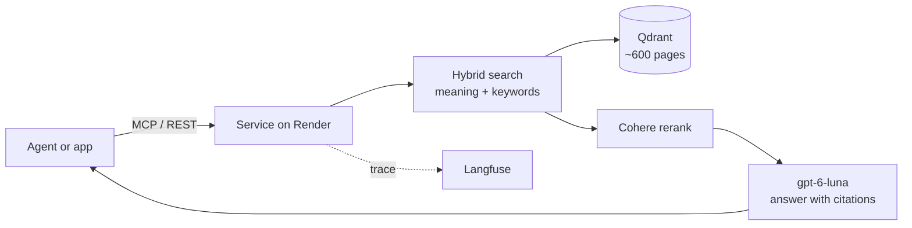
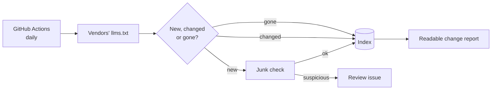

# rag-context-assembly

**Ask questions about Claude Code, Cursor, Codex and MCP — get answers grounded in their official docs, with citations.**

A hybrid RAG service that AI agents call as an MCP tool (or over REST). It
indexes ~600 pages of official documentation, refreshes itself daily, and every
design choice is backed by an experiment.

> Why it is built this way, what was tested, and a glossary of every term:
> **[ARCHITECTURE.md](ARCHITECTURE.md)**

---

## How it works



1. **Search** the docs two ways at once: by meaning (embeddings) and by exact words (BM25).
2. **Rerank** the 10 best candidates with Cohere and drop weak matches.
3. **Answer** from the top 8 passages only, citing each claim as [1], [2].
   If nothing relevant is found, it says the docs do not cover the question.

## Fresh every day



New pages are indexed automatically; suspicious ones wait for a human. Each run
writes a short report of what changed in the products: [reports/docs-changes/](reports/docs-changes/).

## What it covers

| Product | Source |
|---|---|
| Claude Code (incl. Agent SDK, plugins) | `code.claude.com/docs/llms.txt` |
| Cursor | `cursor.com/llms.txt` |
| Codex | `developers.openai.com/codex/llms.txt` |
| MCP (latest spec, registry, extensions) | `modelcontextprotocol.io/llms.txt` |

---

## Connect

**As an MCP server** (Claude Code, Cursor, OpenWebUI, any MCP client):

```json
{
  "mcpServers": {
    "agent-docs": {
      "url": "https://agent-docs-mcp.onrender.com/mcp/",
      "headers": { "Authorization": "Bearer <API_TOKEN>" }
    }
  }
}
```

| Tool | Returns |
|---|---|
| `ask_docs(question)` | A grounded answer with sources |
| `search_docs(query, limit=8, product=None, response_format="concise")` | Ranked passages only (cheaper; the agent reasons itself). `product`: `claude-code`, `cursor`, `codex`, `mcp` |

**Over REST:**

```bash
curl -X POST https://agent-docs-mcp.onrender.com/ask \
  -H "Authorization: Bearer $API_TOKEN" -H 'content-type: application/json' \
  -d '{"question": "How do I add an MCP server in Claude Code?"}'
```

| Endpoint | Purpose |
|---|---|
| `GET /health` | Liveness, no token |
| `POST /ask` | Answer with citations |
| `POST /search` | Passages only |
| `POST /mcp/` | MCP (streamable HTTP) |
| `GET /docs` | Interactive API docs (use **Authorize** with the token) |

Want to try it? Ask the owner for a guest token. The first request after
15 idle minutes takes about a minute (free hosting wakes up).

**Locally, without a server** (stdio, no token):

```json
{ "mcpServers": { "agent-docs": { "command": "uv",
  "args": ["run", "--directory", "/path/to/rag-context-assembly", "rag-mcp"] } } }
```

---

## Where it runs

| Part | Service | Plan |
|---|---|---|
| API + MCP server | Render (`agent-docs-mcp.onrender.com`) | Free web service |
| Vector index | Qdrant Cloud | Free 1 GB cluster |
| Traces, eval datasets, prompts | Langfuse Cloud | Free Hobby |
| Daily re-index, CI | GitHub Actions | Free |
| Embeddings, answers | OpenAI (`text-embedding-3-small`, `gpt-6-luna`) | Pay per use |
| Rerank | Cohere (`rerank-v4.0-fast`) | Trial key + fallback key |

Deploys run only after CI passes. The whole service is defined in
[render.yaml](render.yaml).

**Deploy your own:** Render → New → Blueprint → this repo. Fill the secrets it
asks for (`OPENAI_API_KEY`, `COHERE_API_KEY`, optional `COHERE_API_KEY_FALLBACK`,
`QDRANT_URL`, `QDRANT_API_KEY`, `LANGFUSE_PUBLIC_KEY`, `LANGFUSE_SECRET_KEY`);
`API_TOKEN` is generated for you. If you change the host name, update
`API_ALLOWED_HOSTS` (the MCP transport rejects unknown hosts). Revoke a guest
by clearing `API_GUEST_TOKEN`.

## Cost

| What | Cost |
|---|---|
| Hosting, database, tracing, CI | **$0 / month** (free tiers) |
| One answer (`ask_docs`) | **≈ $0.0007** (OpenAI; rerank on the free trial) |
| One search (`search_docs`) | ≈ $0 (one embedding + one rerank) |
| Daily re-index, nothing changed | $0 |
| Daily re-index, a few pages changed | < $0.01 (embeddings + one short LLM check per new page) |
| Full rebuild of the index | ≈ $0.10 one-off |

Limits of the free setup: Cohere trial allows 1,000 reranks/month per key
(two keys) and 10/minute; the API is capped at 60 paid requests/minute.

---

## Key results

| Change | Measured effect |
|---|---|
| 8 chunks instead of 5 | Questions fully covered: 25% → 75% |
| English translation of non-English questions | Hit@5: 0.958 → 1.000 |
| Candidate pool 10, not 20 | Fully covered: 75% vs 50% (more recall pushed out the second topic) |
| `gpt-6-luna` instead of `gpt-5.6-luna` | Faithfulness: 0.975 → 0.994 |
| Stable tie-break in RRF | Same question → same results (was random) |

Main finding: **search finds the right page; the hard part is choosing what
the model sees.** Details and every experiment: [ARCHITECTURE.md](ARCHITECTURE.md).

---

## Develop

```bash
uv sync --locked                      # Python 3.14
cp .env.example .env                  # OpenAI, Cohere, Qdrant, Langfuse keys
docker compose up -d                  # local Qdrant + API on :8080
uv run python -m src.ask "How do skills work?"
uv run pytest -q && uv run ruff check src evals tests && uv run mypy
```

Re-index locally: `uv run python -m src.reindex --dry-run --out /tmp/r`
(no writes) — or run the **Reindex** workflow in GitHub Actions.

| Folder | Contents |
|---|---|
| `src/ingestion/` | Page selection, chunking, junk gate, change report |
| `src/rag/` | Search, rerank, context selection, generation |
| `src/service/` | REST API and MCP server (one shared handler) |
| `evals/` | Datasets and experiment runners (Langfuse) |
| `reports/` | Experiment outputs and daily change reports |
