# Agent Docs

**An MCP server that gives AI agents the current official documentation of Claude Code, Cursor, Codex and MCP.**

These tools change faster than a model's training data. Agent Docs keeps
about 600 pages of their official docs in a search index, refreshes it every
day, and gives your agent two tools: one finds the right passage, the other
reads a whole section. The agent answers from the real docs and can link to
them.

It runs as a remote MCP server (and over REST). You can try it with a free
Cohere key.

<picture>
  <source media="(prefers-color-scheme: dark)" srcset="docs/flow/agent-docs-flow-dark.gif">
  
</picture>

**[Step through it at your own pace](https://konstantinstarovoytov.github.io/agent-docs/)** (arrow keys work), or open the stills:

<details>
<summary>The 15 steps as still images</summary>

<picture>
  <source media="(prefers-color-scheme: dark)" srcset="docs/flow/steps/step-01-dark.webp">
  
</picture>

<picture>
  <source media="(prefers-color-scheme: dark)" srcset="docs/flow/steps/step-02-dark.webp">
  
</picture>

<picture>
  <source media="(prefers-color-scheme: dark)" srcset="docs/flow/steps/step-03-dark.webp">
  
</picture>

<picture>
  <source media="(prefers-color-scheme: dark)" srcset="docs/flow/steps/step-04-dark.webp">
  
</picture>

<picture>
  <source media="(prefers-color-scheme: dark)" srcset="docs/flow/steps/step-05-dark.webp">
  
</picture>

<picture>
  <source media="(prefers-color-scheme: dark)" srcset="docs/flow/steps/step-06-dark.webp">
  
</picture>

<picture>
  <source media="(prefers-color-scheme: dark)" srcset="docs/flow/steps/step-07-dark.webp">
  
</picture>

<picture>
  <source media="(prefers-color-scheme: dark)" srcset="docs/flow/steps/step-08-dark.webp">
  
</picture>

<picture>
  <source media="(prefers-color-scheme: dark)" srcset="docs/flow/steps/step-09-dark.webp">
  
</picture>

<picture>
  <source media="(prefers-color-scheme: dark)" srcset="docs/flow/steps/step-10-dark.webp">
  
</picture>

<picture>
  <source media="(prefers-color-scheme: dark)" srcset="docs/flow/steps/step-11-dark.webp">
  
</picture>

<picture>
  <source media="(prefers-color-scheme: dark)" srcset="docs/flow/steps/step-12-dark.webp">
  
</picture>

<picture>
  <source media="(prefers-color-scheme: dark)" srcset="docs/flow/steps/step-13-dark.webp">
  
</picture>

<picture>
  <source media="(prefers-color-scheme: dark)" srcset="docs/flow/steps/step-14-dark.webp">
  
</picture>

<picture>
  <source media="(prefers-color-scheme: dark)" srcset="docs/flow/steps/step-15-dark.webp">
  
</picture>

<sub>Source and how to rebuild: [docs/flow/](docs/flow/)</sub>

</details>

How it was built and what was measured: [ARCHITECTURE.md](ARCHITECTURE.md).

---

## Connect

Add the server to any MCP client (Claude Code, Cursor, OpenWebUI and others):

```json
{
  "mcpServers": {
    "agent-docs": {
      "url": "https://agent-docs-mcp.onrender.com/mcp/",
      "headers": { "X-Cohere-Api-Key": "<your Cohere key>" }
    }
  }
}
```

Calling a tool needs one of two headers:

- **Your own Cohere key:** `X-Cohere-Api-Key: <key>`. A free trial key is at
  [dashboard.cohere.com](https://dashboard.cohere.com). The key pays for
  reranking that one request; it is never stored or logged. Limit: 30 requests
  a minute per IP.
- **A token from the owner:** `Authorization: Bearer <API_TOKEN>`. For a guest
  token, open an
  [issue](https://github.com/KonstantinStarovoytov/agent-docs/issues/new?title=Guest%20token%20request)
  titled "Guest token request".

The server is on a free plan: after 15 idle minutes, the first request takes
about a minute.

| Tool | What it returns |
|---|---|
| `search_docs(query, limit=8, product=None, response_format="concise")` | The best passage from each matching page, ranked, with the page's one-line description and a relevance score. Ask about one topic per call. `product`: `claude-code`, `cursor`, `codex`, `mcp` |
| `read_section(url, heading=None, offset=0, outline_depth=2)` | Without a heading: the page's description and outline (`outline_depth=3` adds subsections). With a heading: the whole section, up to 8,000 characters per call (`next_offset` gives the rest) |

**Over REST:**

```bash
curl -X POST https://agent-docs-mcp.onrender.com/ask \
  -H "Authorization: Bearer $API_TOKEN" -H 'content-type: application/json' \
  -d '{"question": "How do I add an MCP server in Claude Code?"}'
```

With your own key, replace the `Authorization` line with
`-H "X-Cohere-Api-Key: $COHERE_API_KEY"`.

| Endpoint | Purpose |
|---|---|
| `GET /health` | Liveness, no token |
| `POST /ask` | A written answer with citations |
| `POST /search` | Passages with page descriptions (`search_docs`) |
| `POST /pages` | Page cards: description and outline |
| `POST /section` | One section of a page (`read_section`) |
| `POST /mcp/` | MCP (streamable HTTP) |
| `GET /docs` | Interactive API docs (use **Authorize** with the token) |

**Locally, without a server** (stdio, no token):

```json
{ "mcpServers": { "agent-docs": { "command": "uv",
  "args": ["run", "--directory", "/path/to/agent-docs", "rag-mcp"] } } }
```

**For MCP directories:** connecting and listing the tools need no key (30
requests a minute per IP); only `tools/call` does. The server keeps no session,
so `GET /mcp` answers 405; send everything with POST. Listed in the
[official MCP Registry](https://registry.modelcontextprotocol.io) as
`io.github.KonstantinStarovoytov/agent-docs` ([server.json](server.json)).

## What it covers

| Product | Source |
|---|---|
| Claude Code (incl. Agent SDK, plugins) | `code.claude.com/docs/llms.txt` |
| Cursor | `cursor.com/llms.txt` |
| Codex | `developers.openai.com/codex/llms.txt` |
| MCP (latest spec, registry, extensions) | `modelcontextprotocol.io/llms.txt` |

---

## How it works

Your agent calls `search_docs`, then `read_section` when a passage is not
enough. No language model runs on the server for this: the agent reads the
passages and writes the answer itself.

`search_docs` works in four steps:

1. It searches by meaning (embeddings) and by exact words (BM25) at the same
   time, so both "connect a tool server" and `claude mcp add` find the right
   page.
2. It merges the two result lists by rank. Ties are kept in a fixed order, so
   the same question always gets the same results.
3. A reranker (Cohere) reads the top 20 together with the question and scores
   how well each one matches.
4. It keeps the best passage of each page and adds the page's one-line
   description and the headings of its other matching sections.

`read_section` reads from a stored copy of the page; no model is called.
Searches are traced in Langfuse.

The REST endpoint `/ask` is for clients that are not agents. It also
translates Russian and Polish questions into English, says "the documentation
does not cover this" when even the best candidate scores below 0.55, picks 8
chunks (at most 2 from one section), and has `gpt-6-luna` write an answer that
cites them.

## Updated every day

<picture>
  <source media="(prefers-color-scheme: dark)" srcset="docs/flow/reindex-flow-dark.gif">
  
</picture>

**[Step through it at your own pace](https://konstantinstarovoytov.github.io/agent-docs/?flow=reindex)**, or open the stills:

<details>
<summary>The 12 steps as still images</summary>

<picture>
  <source media="(prefers-color-scheme: dark)" srcset="docs/flow/steps/reindex-01-dark.webp">
  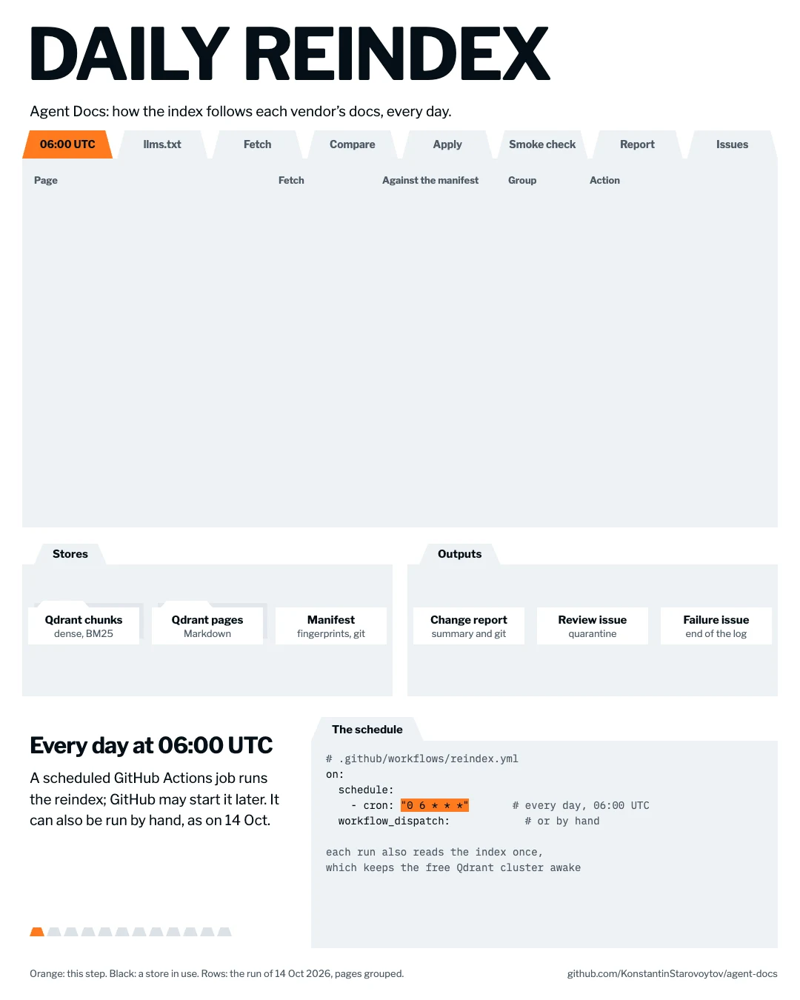
</picture>

<picture>
  <source media="(prefers-color-scheme: dark)" srcset="docs/flow/steps/reindex-02-dark.webp">
  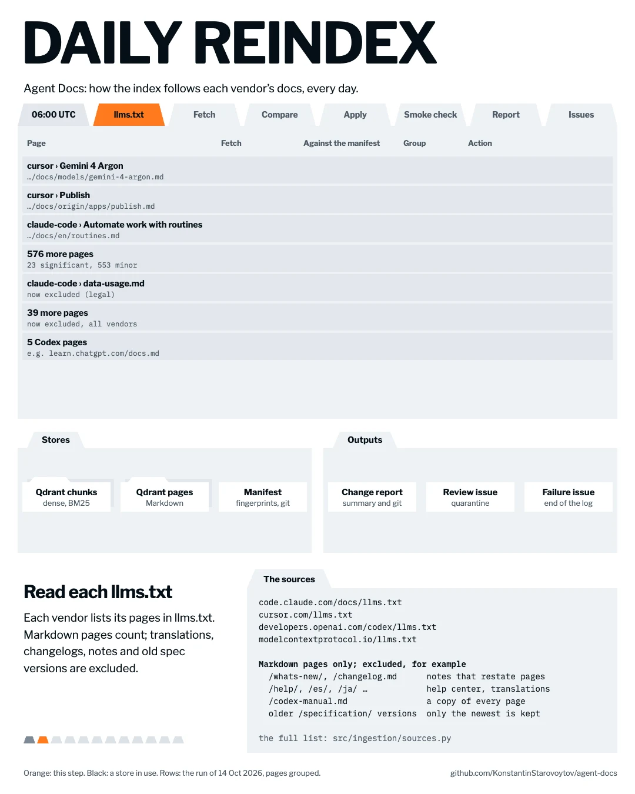
</picture>

<picture>
  <source media="(prefers-color-scheme: dark)" srcset="docs/flow/steps/reindex-03-dark.webp">
  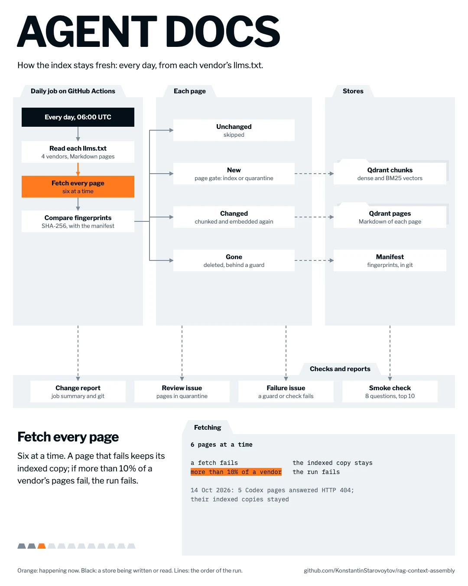
</picture>

<picture>
  <source media="(prefers-color-scheme: dark)" srcset="docs/flow/steps/reindex-04-dark.webp">
  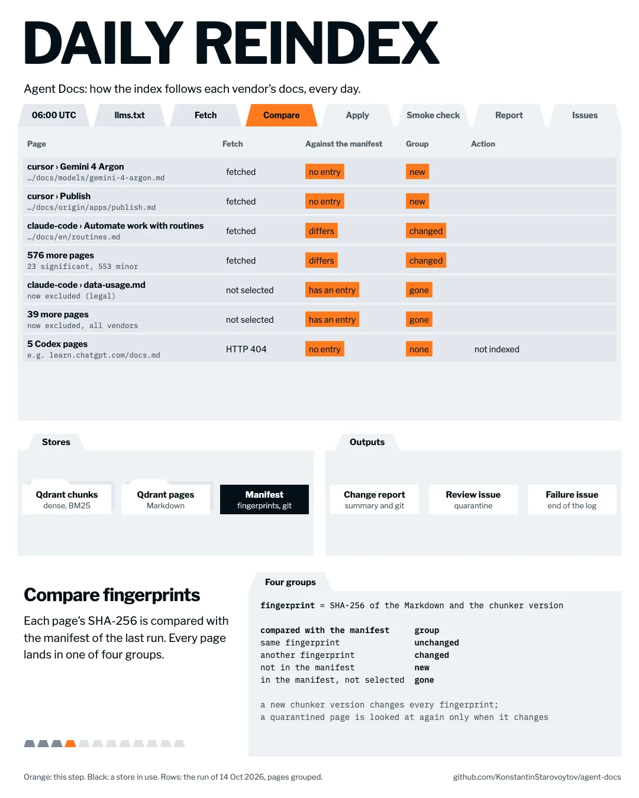
</picture>

<picture>
  <source media="(prefers-color-scheme: dark)" srcset="docs/flow/steps/reindex-05-dark.webp">
  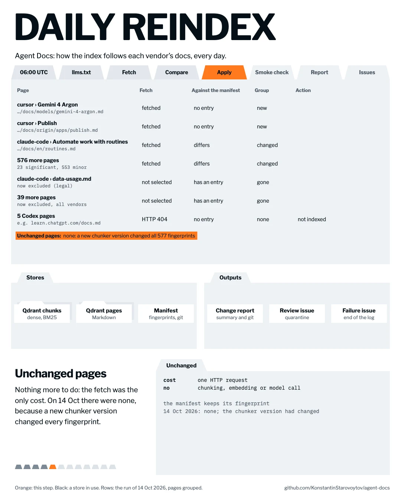
</picture>

<picture>
  <source media="(prefers-color-scheme: dark)" srcset="docs/flow/steps/reindex-06-dark.webp">
  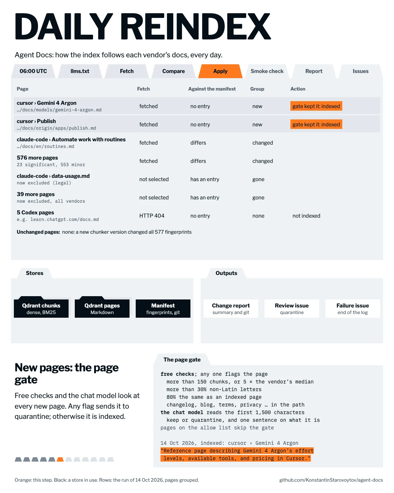
</picture>

<picture>
  <source media="(prefers-color-scheme: dark)" srcset="docs/flow/steps/reindex-07-dark.webp">
  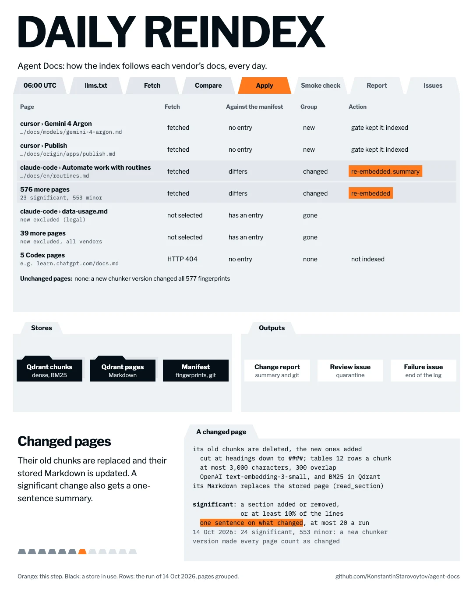
</picture>

<picture>
  <source media="(prefers-color-scheme: dark)" srcset="docs/flow/steps/reindex-08-dark.webp">
  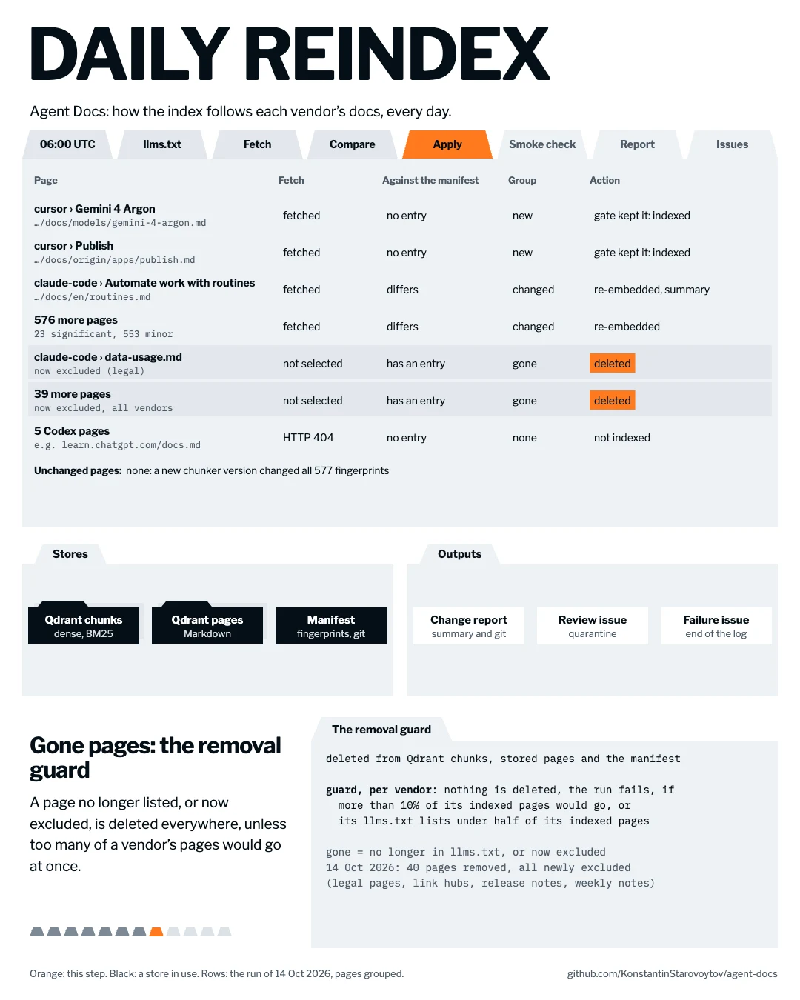
</picture>

<picture>
  <source media="(prefers-color-scheme: dark)" srcset="docs/flow/steps/reindex-09-dark.webp">
  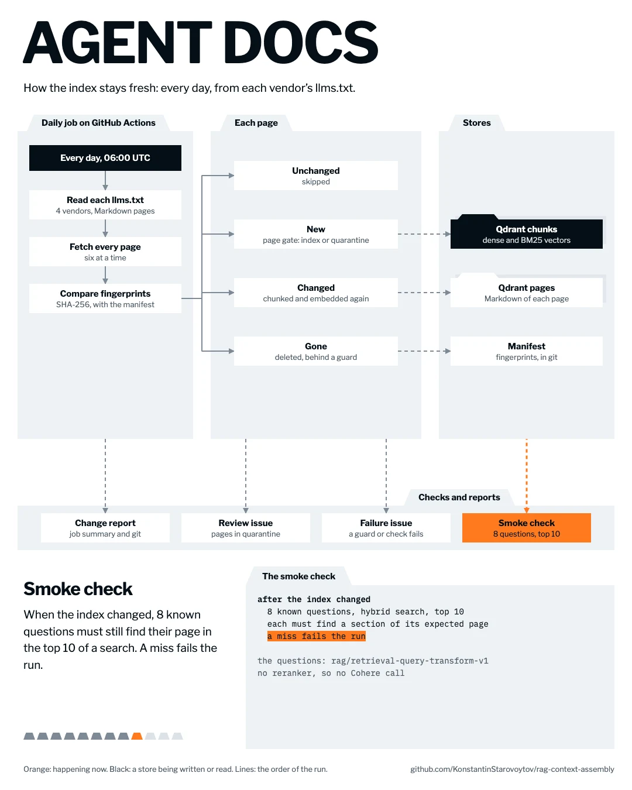
</picture>

<picture>
  <source media="(prefers-color-scheme: dark)" srcset="docs/flow/steps/reindex-10-dark.webp">
  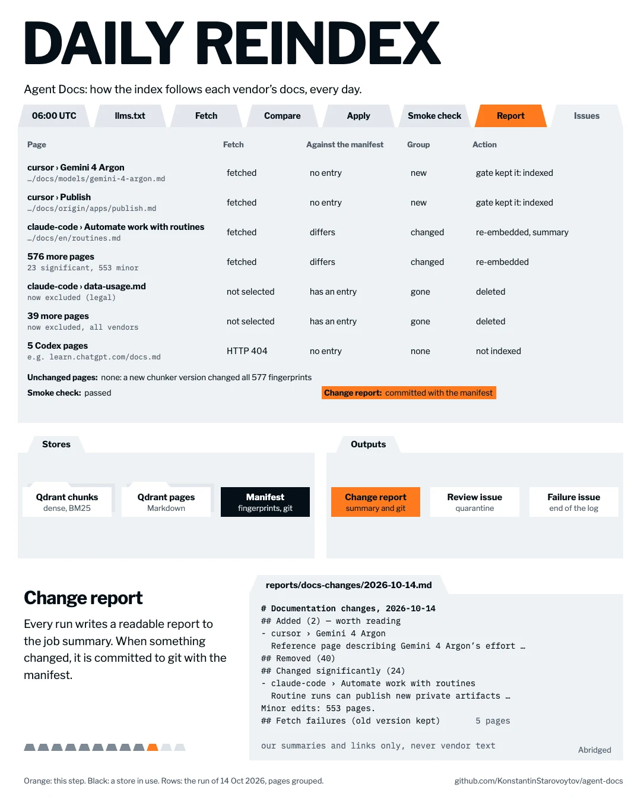
</picture>

<picture>
  <source media="(prefers-color-scheme: dark)" srcset="docs/flow/steps/reindex-11-dark.webp">
  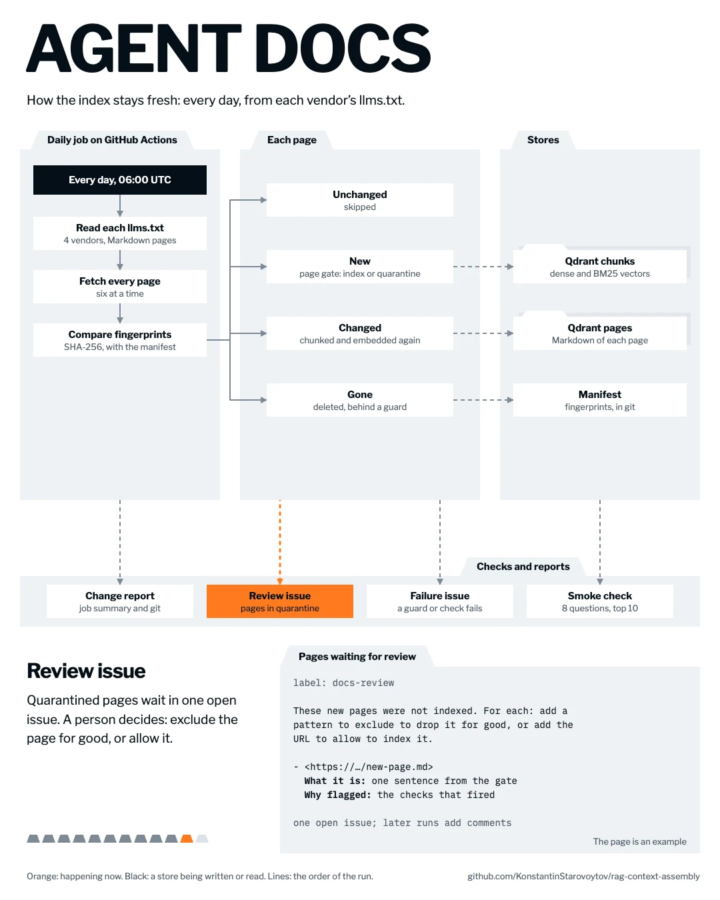
</picture>

<picture>
  <source media="(prefers-color-scheme: dark)" srcset="docs/flow/steps/reindex-12-dark.webp">
  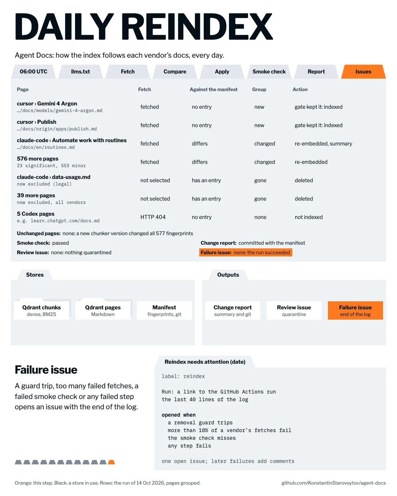
</picture>

</details>

Every day at 06:00 UTC a GitHub Actions job reads each vendor's list of pages
(`llms.txt`) and updates the index:

- Changed pages are embedded again; unchanged ones are skipped.
- New pages are checked first. A suspicious one waits in a GitHub issue until
  the owner ticks **Index** or **Decline**.
- Pages that disappear from the list are deleted, unless too many disappear at
  once.
- A short report of what changed in the products goes to
  [reports/docs-changes/](reports/docs-changes/).

## Measured results

Each change was measured on labelled questions before it was kept. All
experiments, including the ones that did not work:
[ARCHITECTURE.md](ARCHITECTURE.md#experiments).

| Change | Measured effect |
|---|---|
| 8 chunks instead of 5 for `/ask` | Multi-part questions fully covered: 25% → 75% |
| English copy of non-English questions | Hit@5: 0.958 → 1.000 |
| 10 candidates for the reranker, not 20 | Fully covered: 75% vs 50% (the extra candidates pushed out the second topic) |
| `gpt-6-luna` instead of `gpt-5.6-luna` | Faithfulness: 0.975 → 0.994 |
| Ties in a fixed order | The same question gets the same results (it did not before) |
| One passage per page in `search_docs` | Distinct pages in the top 5: 3.1 → 5.0; page hit@5: 0.936 → 0.979 |
| Headings of a page's other matching sections (`other_sections`) | Labelled section visible: 0.667 → 0.867; with real agents, the same correctness and fewer failed section reads (11 → 1) |

When an answer misses part of a question, the search has usually found the
right text. It gets lost later, when the candidates are cut down to what the
model sees.

---

## Where it runs

| Part | Service | Plan |
|---|---|---|
| API + MCP server | Render, service `agent-docs` at `agent-docs-mcp.onrender.com` | Free web service |
| Vector index | Qdrant Cloud | Free 1 GB cluster |
| Traces, eval datasets, prompts | Langfuse Cloud | Free Hobby |
| Daily re-index, CI | GitHub Actions | Free |
| Embeddings, answers | OpenAI (`text-embedding-3-small`, `gpt-6-luna`) | Pay per use |
| Rerank | Cohere (`rerank-v4.0-fast`) | Trial key + fallback key |

Deploys run only after CI passes. The whole service is defined in
[render.yaml](render.yaml).

**Deploy your own:** Render → New → Blueprint → this repo. Fill the secrets it
asks for (`OPENAI_API_KEY`, `COHERE_API_KEY`, optional `COHERE_API_KEY_FALLBACK`,
`QDRANT_URL`, `QDRANT_API_KEY`, `LANGFUSE_PUBLIC_KEY`, `LANGFUSE_SECRET_KEY`);
`API_TOKEN` is generated for you. If you change the host name, update
`API_ALLOWED_HOSTS` (the MCP transport rejects unknown hosts). Revoke a guest
by clearing `API_GUEST_TOKEN`.

## Cost

| What | Cost |
|---|---|
| Hosting, database, tracing, CI | **$0 / month** (free tiers) |
| One answer (`/ask`) | **≈ $0.0007** (OpenAI; rerank on the free trial) |
| One search (`search_docs`) | ≈ $0 (one embedding + one rerank) |
| Daily re-index, nothing changed | $0 |
| Daily re-index, a few pages changed | < $0.01 (embeddings + one short LLM check per new page) |
| Full rebuild of the index | ≈ $0.10–0.30 one-off (embeddings ≈ $0.07 + one short LLM check per page) |

Limits of the free setup: Cohere trial allows 1,000 reranks/month per key
(two keys) and 10/minute; the API is capped at 60 paid requests/minute.

---

## Develop

```bash
uv sync --locked                      # Python 3.14
cp .env.example .env                  # OpenAI, Cohere, Qdrant, Langfuse keys
docker compose up -d                  # local Qdrant + API on :8080
uv run python -m src.ask "How do skills work?"
uv run pytest -q && uv run ruff check src evals tests && uv run ruff format --check src evals tests && uv run mypy
```

Re-index locally: `uv run python -m src.reindex --dry-run --out /tmp/r`
(no writes) — or run the **Reindex** workflow in GitHub Actions.

| Folder | Contents |
|---|---|
| `src/ingestion/` | Page selection, chunking, junk gate, change report |
| `src/rag/` | Search, rerank, context selection, generation |
| `src/service/` | REST API and MCP server (one shared handler) |
| `src/prompts/` | Prompts, versioned in Langfuse |
| `evals/` | The eval gate: datasets, runners, scorers ([guide](evals/README.md)) |
| `reports/` | Experiment results and daily change reports ([index](reports/README.md)) |
| `docs/` | Diagrams, the animation, findings, publishing notes |
| `data/manifests/` | What each index holds, page by page |
| `scripts/` | Diagram rendering, Langfuse CLI with the project's keys |

Diagrams: edit `docs/diagrams/*.mmd`, then `uv run python scripts/render_diagrams.py`.
Animations: edit `docs/flow/flows/ask.js` (a question) or `docs/flow/flows/reindex.js`
(the daily reindex), then `docs/flow/render.sh`.

## License

[MIT](LICENSE)
